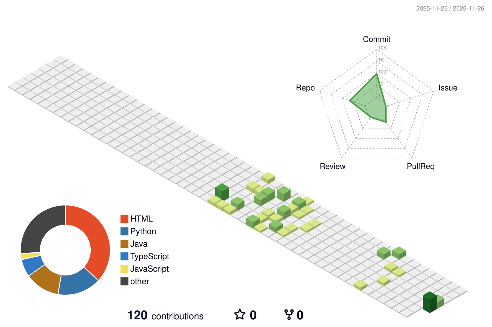
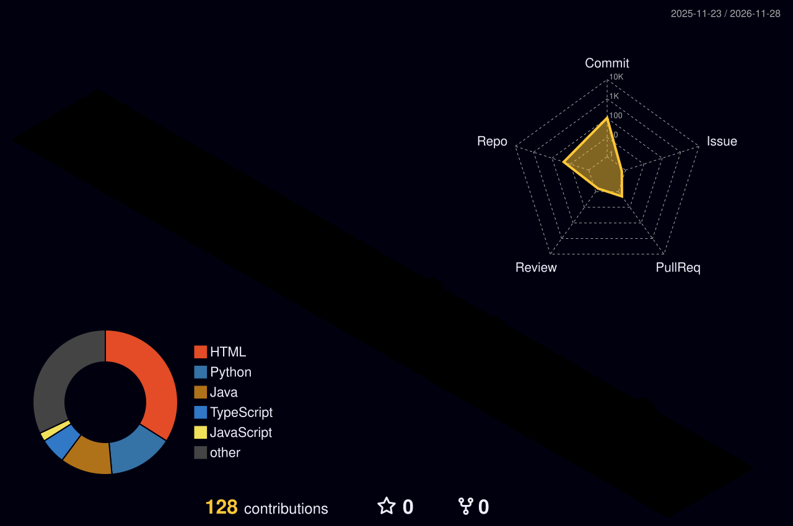

  

  

  
  
  

  
  
  

  

<h2 align="center">About Me</h2>

<table align="center">
<tr>
<td width="60%" valign="top">

I'm a Computer Science Engineering student at Parul University and an aspiring Java Backend Developer.

I build backend systems and REST APIs with Spring Boot, Spring Data JPA, Hibernate and MySQL, including JWT authentication, role-based access control and transactional workflows. I focus on clean, maintainable and well-structured code.

Cybersecurity is part of my academic background, and I bring that awareness into the code I write.

</td>
<td width="40%" valign="top" align="center">

</td>
</tr>
</table>

<h2 align="center">Current Focus</h2>

<table align="center">
<tr>
<td align="center" width="25%" valign="top">
  
<b>Java and Spring Boot</b> 
Spring Framework, Spring Data JPA, Spring Security
</td>
<td align="center" width="25%" valign="top">
  
<b>REST APIs, JPA and JWT</b> 
DTOs, validation, exception handling, role-based access
</td>
<td align="center" width="25%" valign="top">
  
<b>SQL and Databases</b> 
Schema design, relationships, queries, data management
</td>
<td align="center" width="25%" valign="top">
  
<b>OOP and DSA</b> 
Object-oriented design, data structures, algorithms
</td>
</tr>
</table>

<h2 align="center">Tech Stack</h2>

  

<table align="center">
<tr>
<td align="center"><b>Backend</b></td>
<td>

</td>
</tr>
<tr>
<td align="center"><b>Database</b></td>
<td>

</td>
</tr>
<tr>
<td align="center"><b>Languages</b></td>
<td>

</td>
</tr>
<tr>
<td align="center"><b>Frontend</b></td>
<td>

</td>
</tr>
<tr>
<td align="center"><b>Tools</b></td>
<td>

</td>
</tr>
</table>

<h2 align="center">Backend Development Skills</h2>

<table align="center">
<tr>
<th align="center">API Design</th>
<th align="center">Data Layer</th>
<th align="center">Security and Reliability</th>
<th align="center">Fundamentals</th>
</tr>
<tr>
<td valign="top">
&bull; RESTful endpoints 
&bull; Request / response DTOs 
&bull; Input validation 
&bull; Controller-Service-Repository
</td>
<td valign="top">
&bull; Entity mapping 
&bull; Spring Data JPA repositories 
&bull; SQL queries 
&bull; Database relationships
</td>
<td valign="top">
&bull; JWT authentication 
&bull; Role-based authorization 
&bull; Exception handling 
&bull; Audit logging
</td>
<td valign="top">
&bull; OOP principles 
&bull; Collections Framework 
&bull; Data structures 
&bull; Algorithms
</td>
</tr>
</table>

<h2 align="center">Featured Projects</h2>

  

<table align="center">
<tr>
<td width="50%" valign="top">

<h3 align="center">ProcureFlow</h3>

<i>Enterprise Procurement &amp; Purchase Management System</i>

  
  
  
  
  

<ul>
  <li>REST APIs for purchase requests, approvals, vendors, purchase orders, goods receipts and invoices</li>
  <li>Three-way invoice matching</li>
  <li>Role-based access, audit logging and transactional workflows</li>
</ul>

  <!-- Replace with the exact repository URL if the name differs -->
  

</td>
<td width="50%" valign="top">

<h3 align="center">TenantSphere</h3>

<i>Multi-Tenant SaaS Subscription &amp; Usage Management Platform</i>

  
  
  
  
  

<ul>
  <li>Multi-tenant backend with organization management and tenant-level data isolation</li>
  <li>JWT authentication and role-based authorization</li>
  <li>Subscription upgrades, feature limits and usage tracking</li>
</ul>

  <!-- Replace with the exact repository URL if the name differs -->
  

</td>
</tr>
</table>

<h3 align="center">In Progress</h3>

<table align="center">
<tr>
<td width="50%" valign="top">

**Task Management REST API**

A Spring Boot REST API for managing tasks, with DTOs and mappers, exception handling, and task status and priority enums.

</td>
<td width="50%" valign="top">

**Library Management System**

A Spring Boot backend modelled around books, authors and categories, with repositories, DTOs, and service and controller layers.

</td>
</tr>
</table>

<h3 align="center">Other Projects</h3>

<table align="center">
<tr>
<td width="50%" valign="top">

**Async Weather Dashboard**

Consumes a third-party REST API using Fetch and Async/Await, with structured error handling and a responsive layout.

</td>
<td width="50%" valign="top">

**Task Manager Application**

Browser-based task manager with full CRUD operations, LocalStorage persistence and dynamic DOM updates.

</td>
</tr>
</table>

<h2 align="center">Problem Solving &amp; DSA</h2>

  
  

Arrays &middot; Strings &middot; Hashing &middot; Binary Search &middot; Sliding Window &middot; Two Pointers &middot; Prefix Sum &middot; Linked Lists 
Practised primarily in Java.

<h2 align="center">Experience</h2>

<table align="center">
<tr>
<th>Period</th>
<th>Role</th>
<th>Organisation</th>
</tr>
<tr>
<td>Jun 2026 &ndash; Jul 2026</td>
<td><b>Java Developer Intern</b></td>
<td>CodeAlpha (Remote)</td>
</tr>
<tr>
<td>Jun 2026 &ndash; Jul 2026</td>
<td>Cyber Security Intern</td>
<td>Prodigy InfoTech (Remote)</td>
</tr>
<tr>
<td>Jan 2026 &ndash; Jun 2026</td>
<td>Lab Technical Support Intern</td>
<td>System Support Cell, Parul University</td>
</tr>
</table>

<b>Java Developer Intern &middot; CodeAlpha (Remote)</b>

 
<ul>
  <li>Developed 3+ Java applications applying OOP principles (encapsulation, inheritance, polymorphism), each delivered within defined project timelines</li>
  <li>Solved 15+ algorithmic programming challenges to strengthen data structures and Java fundamentals</li>
  <li>Acted on mentor feedback to improve code quality and software design practices</li>
</ul>

<b>Cyber Security Intern &middot; Prodigy InfoTech (Remote)</b>

 
<ul>
  <li>Built Python-based security tools applying secure coding principles and classical cryptographic techniques, including a Caesar Cipher encryption/decryption application</li>
  <li>Maintained structured Git repositories with consistent commit history across all deliverables</li>
  <li>Wrote technical documentation and project reports for technical and non-technical audiences</li>
</ul>

<b>Lab Technical Support Intern &middot; System Support Cell, Parul University</b>

 
<ul>
  <li>Diagnosed and resolved hardware, software and peripheral issues across 50+ workstations in 5 computer laboratories</li>
  <li>Installed and configured operating systems and applications for 200+ end users using standardized imaging workflows</li>
  <li>Performed weekly updates, hardware diagnostics and network troubleshooting to keep lab operations running</li>
</ul>

<h2 align="center">Education</h2>

<table align="center">
<tr>
<th>Degree</th>
<th>Institution</th>
<th>Score</th>
<th>Year</th>
</tr>
<tr>
<td><b>B.Tech, Computer Science Engineering (Cyber Security)</b></td>
<td>Parul University, Vadodara</td>
<td>CGPA 8.05 / 10.0 (through Sem 4)</td>
<td>Expected 2028</td>
</tr>
<tr>
<td>HSC, Science (PCM)</td>
<td>Maharashtra State Board</td>
<td>76.17%</td>
<td>Feb 2024</td>
</tr>
<tr>
<td>SSC</td>
<td>Maharashtra State Board</td>
<td>82.00%</td>
<td>Mar 2022</td>
</tr>
</table>

<h2 align="center">GitHub Statistics</h2>

<table align="center">
<tr>
<td align="center" width="50%" valign="middle">

</td>
<td align="center" width="50%" valign="middle">

</td>
</tr>
</table>

  

  

  

<h2 align="center">Certifications</h2>

<table align="center">
<tr>
<th>Credential</th>
<th>Issuer</th>
<th>Date</th>
</tr>
<tr>
<td>Java Developer Internship Certificate</td>
<td>CodeAlpha</td>
<td>Jun &ndash; Jul 2026</td>
</tr>
<tr>
<td>Cyber Security Internship Certificate</td>
<td>Prodigy InfoTech</td>
<td>Jun &ndash; Jul 2026</td>
</tr>
<tr>
<td>Lab Technical Support Certificate</td>
<td>System Support Cell, Parul University</td>
<td>Jan &ndash; Jun 2026</td>
</tr>
</table>

<h2 align="center">Security Background</h2>

<table align="center">
<tr>
<td width="60%" valign="top">

Cybersecurity is part of my academic background. I've worked with cryptography basics, network fundamentals, web application security and threat/IOC analysis, and I apply that knowledge to write more secure code.

</td>
<td width="40%" valign="top">

**Caesar Cipher Encryption Tool**

CLI encryption and decryption with configurable shift values, built during my Prodigy InfoTech internship.

</td>
</tr>
</table>

<h2 align="center">Connect With Me</h2>

  
  &nbsp;
  
  &nbsp;
  

  

  

